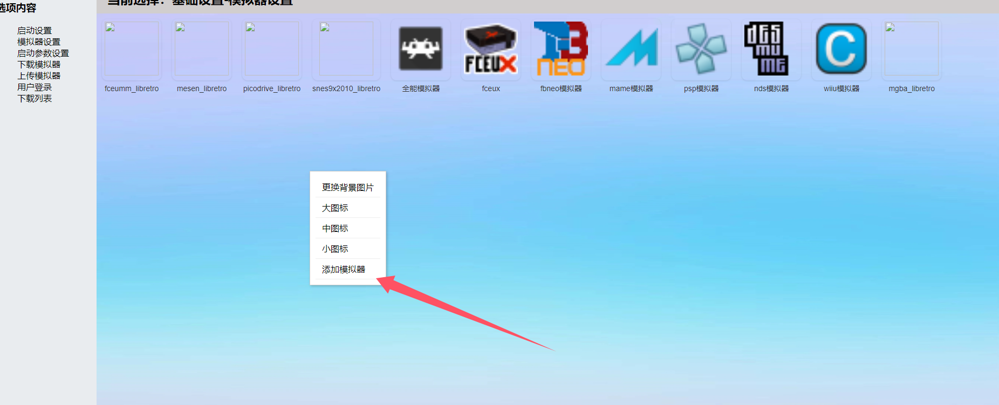
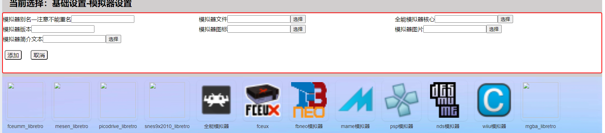

基础设置-模拟器设置
=====================================================

模拟器设置文件UI路径：html/mtn_set.html和html/set_js/mtn_set_content12.js

1 添加模拟器本地

先在空的地方按下鼠标右键→选择添加模拟器

2 根据需要选择添加模拟器，注意一点模拟器的核心文件需要单独添加。然后点击添加按钮
例如 添加全能模拟器 → 按下添加按钮，添加FC模拟器核心 → 按下添加按钮

3 双击模拟器可以直接运行文件，所以这里也可以添加一些常用软件。

4 在图标上点击鼠标右键可以进行相应的修改。

数据库中相关表格。

::

    表emu_config
    字段emu_bg_img  模拟器设置的背景图片
    字段emu_ico_size 图标大小

    表emulations
    字段emu_path 模拟器保存位置
    字段emu_name 模拟器名称
    字段emu_ico  模拟器的图标
    字段emu_core 模拟器核心文件保存位置
    字段emu_img  模拟器图片
    字段emu_txt  模拟器说明文本
    字段emu_ver  模拟器版本信息
    字段emu_md5  模拟器运行文件的MD5值（注意是运行文件的MD5值而不是整个压缩包的值）
    字段emu_core_md5 模拟器核心的md5值