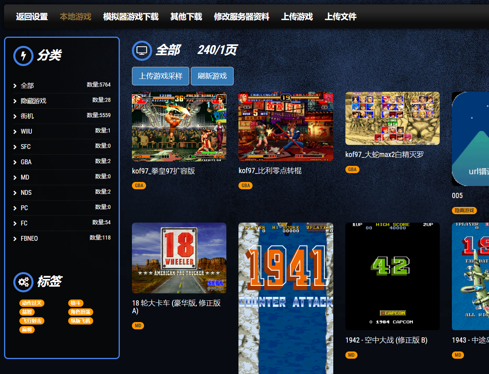
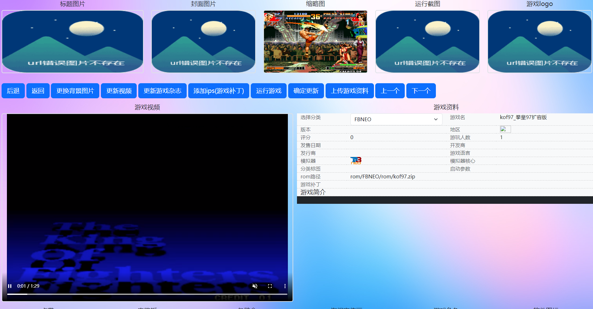
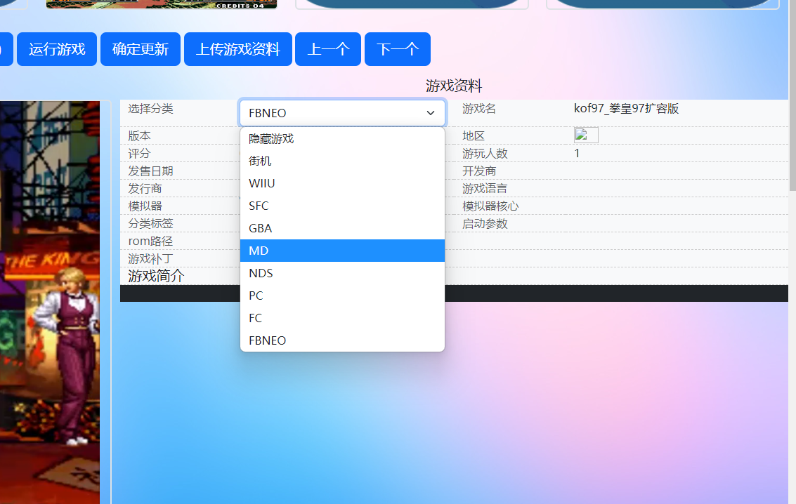

游戏设置---本地游戏
=====================================================

游戏设置文件UI路径：html/set_js/gamehtml/game_index.html

1 上传游戏采样 将你的本地游戏作为样本上传到服务器上面给其他网友资料共享。

2 点击左侧的分类可以选择对应的游戏分类。

3 点击游戏图片可以进入该游戏的资料设计页面。

双击缺少的图片即可添加图片资源。

单机对应的按钮可以添加视频图片等内容。注意上一页下一页按钮是通过id+1的方式来获取的游戏对应id。所以部分游戏因为删除的分类的原因可能会出现没有相应的游戏。

上传游戏资料，是将本地的游戏资料上传到服务器上面，方便其他网友下载使用。

这里是游戏资料对用的文本的部分，注意部分模拟器没有核心文件可能需要手动清楚或修改。

最后填充修改资料结束后一定记得点确定更新按钮。

数据库中相关表格。

::

    表mtn_rom
    字段classify_id  分类id
    字段game_name 游戏名称
    字段game_rom_path 游戏路径
    字段game_thumb_path 游戏缩略图路径
    字段game_video_path 游戏视频路径
    字段game_cassette_path 游戏卡带路径
    字段game_intro_path 游戏介绍路径
    .....具体查看开发日记
