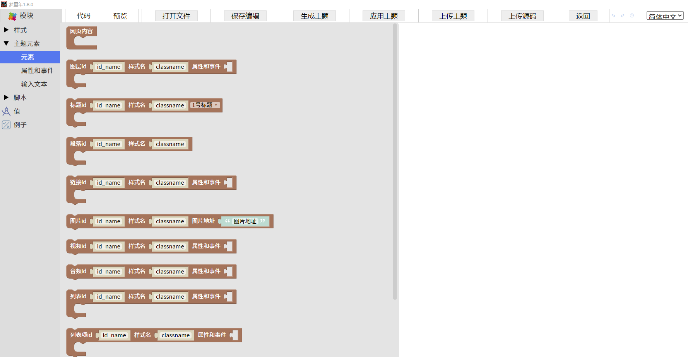

基础设置-制作主题
=====================================================

二创路径 html/blockly/

这里使用的是mixly的blockly修改的积木编程语言。用于制作web主题。主要进行html，css,js代码的编辑具体步骤见主题制作。

1 模块按钮 使用积木语言。

2 代码 查看web页面代码。注意仅支持检测错误，并不支持修改代码。

3 预览 查看UI编辑效果。

4 打开文件 打开编辑的主题文件源码。注意图片，视频，声音等资源是否存在否则看不到效果。源码资源保存路径html/mtnui/file

5 保存编辑 保存编辑主题的源代码。

6 生成主题 将编辑好的主题生成html网页文件。

7 应用主题 将编辑好的主题文件应用到软件上。注意缩略图不要太长否则会超出软件界面无法点击确定按钮。

8 上传主题 将编辑好的主题上传到服务器。（需要登陆账号密码）

9 上传源码 将编辑好的主题源码上传到服务器。（需要登陆账号密码）