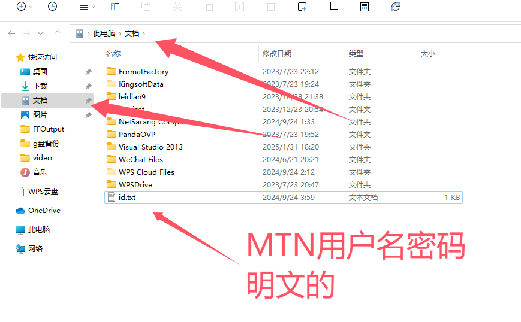

基础设置-用户登录设置
=====================================================

上传模拟器文件UI路径：html/mtn_set.html和html/set_js/mtn_set_content16.js

1 用户登录 修改密码 购买童年币（也可直接和管理员要）需要ipv6网络。

2 用户登录一次后每次打开会自动登录。

3 用户名密码保存在文档的id.txt文件里

