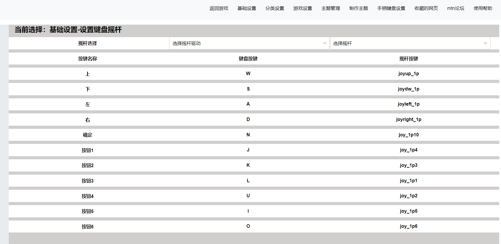

基础设置-设置键盘摇杆
=====================================================

设置键盘摇杆UI路径：html/set_js/mtn_set_content71.js

1 摇杆选择 这里是控制MTN的主题使用的摇杆的各个按键绑定。并非控制模拟器的按键。

2 首先选择摇杆的驱动，然后选择1p或2p摇杆的按键绑定。

3 键盘按键设置不需要选择

4 用鼠标点击键盘按键或则摇杆按键后进行绑定。点击按键以外地方取消选择。