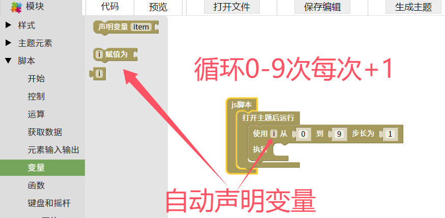
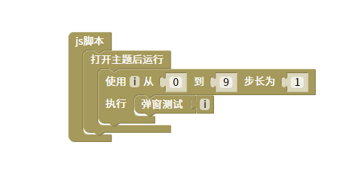

按次数进行重复执行脚本
=======================================================

这里的块只能按次数循环，其实还有很多其他用法，但是这个功能比较简单，所以就只写了这个块。
如果需要其他用法请使用自定义脚本内容（值→最后那个块）。

::

    <body>

    

    </body>

js教程请参考

.. raw:: html

   
<a href="https://www.w3school.com.cn/js/index.asp" target="_blank">w3school</a>

   
<a href="https://www.runoob.com/js/js-tutorial.html" target="_blank">菜鸟教程</a>

