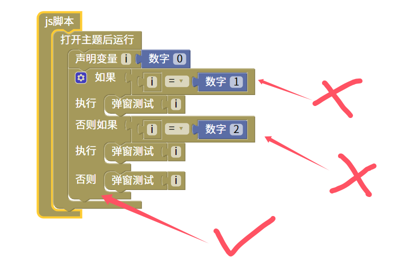

如果否则脚本
=======================================================

根据你设定的条件执行函数。

::

    <body>

    

    </body>

js教程请参考

.. raw:: html

   
<a href="https://www.w3school.com.cn/js/index.asp" target="_blank">w3school</a>

   
<a href="https://www.runoob.com/js/js-tutorial.html" target="_blank">菜鸟教程</a>

