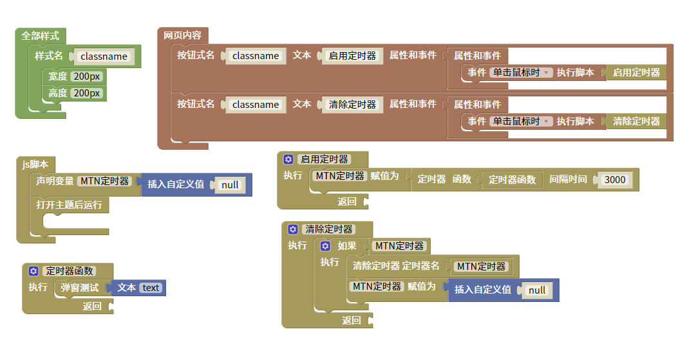

清除定时器脚本
=======================================================

清除设定好的定时器，注意如果在其他函数中设定的定时器清除时需要全局变量。

    
::

    <body>

    

    </body>
    
js教程请参考

.. raw:: html

   
<a href="https://www.w3school.com.cn/js/index.asp" target="_blank">w3school</a>

   
<a href="https://www.runoob.com/js/js-tutorial.html" target="_blank">菜鸟教程</a>

