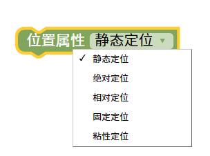

位置属性
=======================================================

改变元素再网页内的位置属性。

1. 静态定位 (static)
默认值：所有 HTML 元素的默认定位方式。
特点：元素按照正常的文档流进行布局，不会受到 top、bottom、left、right 和 z-index 属性的影响。
适用场景：不需要特殊定位时使用
2. 相对定位 (relative)
特点：元素在正常文档流中定位，然后使用 top、bottom、left、right 和 z-index 属性进行定位。
适用场景：需要相对某个位置进行定位时使用
3. 绝对定位 (absolute)
特点：元素脱离文档流，并使用 top、bottom、left、right 和 z-index 属性进行定位。
适用场景：需要绝对定位时使用
4. 固定定位 (fixed)
特点：元素脱离文档流，并使用 top、bottom、left、right 和 z-index 属性进行定位。
适用场景：需要固定定位时使用
5. 粘性定位 (sticky)
特点：元素在正常文档流中定位，然后使用 top、bottom、left、right 和 z-index 属性进行定位。当元素到达指定位置时，会固定在指定位置。
适用场景：需要粘性定位时使用

::

    

测试样式

.. image:: img/12.png