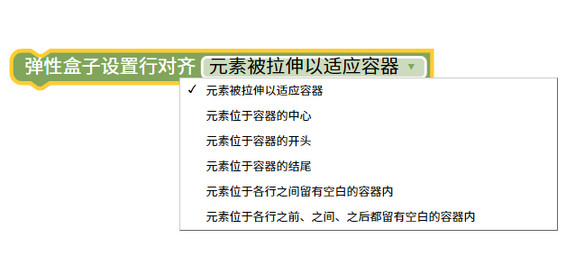
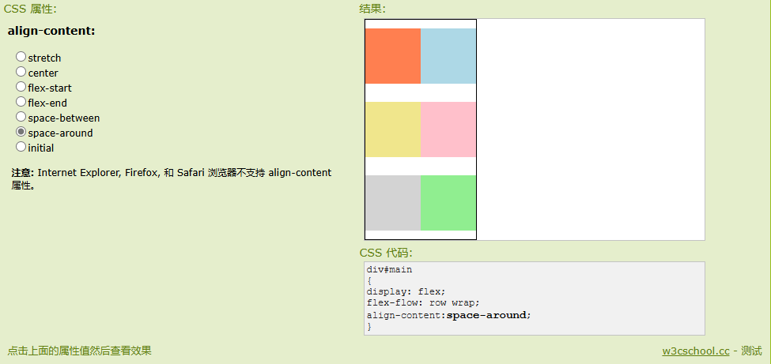

弹性盒子设置行对齐
=======================================================

align-content 属性在弹性容器内的各项没有占用交叉轴上所有可用的空间时对齐容器内的各项（垂直）。

提示：使用 justify-content 属性对齐主轴上的各项（水平）。

注意：容器内必须有多行的项目，该属性才能渲染出效果。

::

    
    
测试样式

.. raw:: html

   <a href="https://www.runoob.com/try/playit.php?f=playcss_align-content&preval=stretch" target="_blank">css样式测试</a>