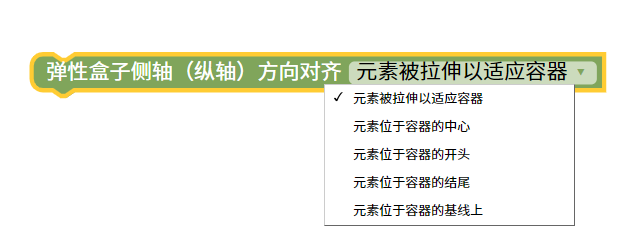
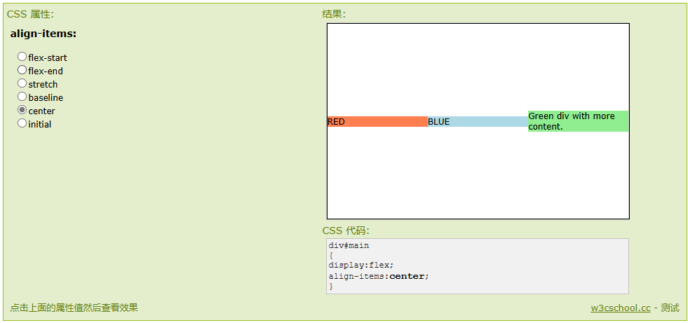

弹性盒子方向对齐
=======================================================

align-items 属性定义flex子项在flex容器的当前行的侧轴（纵轴）方向上的对齐方式。

提示：使用每个弹性对象元素的 align-self 属性可重写 align-items 属性。

::

    
    
测试样式

.. raw:: html

   <a href="https://www.runoob.com/try/playit.php?f=playcss_align-items&preval=stretch" target="_blank">css样式测试</a>