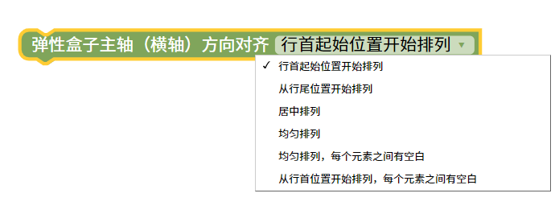
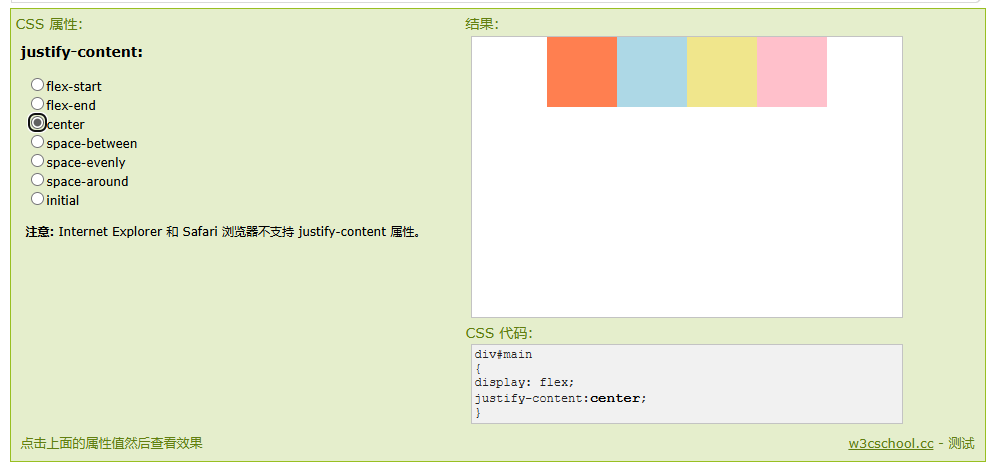

弹性盒子方向对齐
=======================================================

flex-direction 属性规定灵活项目的方向。

注意：如果元素不是弹性盒对象的元素，则 flex-direction 属性不起作用。

::

    
    
测试样式

.. raw:: html

   <a href="https://www.runoob.com/try/playit.php?f=playcss_justify-content&preval=flex-start" target="_blank">css样式测试</a>