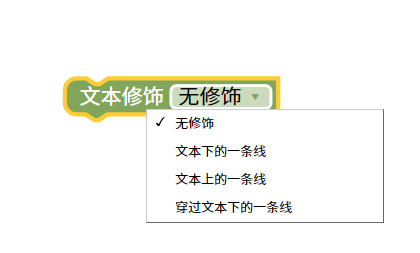
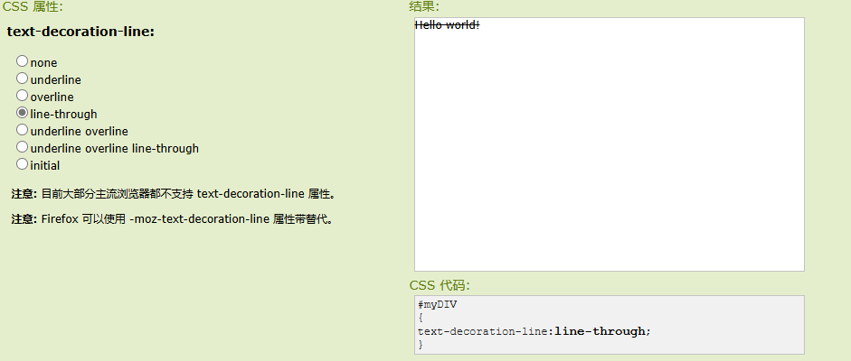

文本修饰
=======================================================

对元素中的文本进行修饰。

::

    

测试样式

.. raw:: html

   <a href="https://www.runoob.com/try/playit.php?f=playcss_text-decoration-line&preval=none" target="_blank">css样式测试</a>