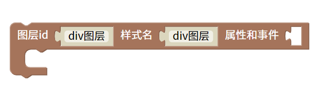

div网页图层
=======================================================

所有主流浏览器都支持 
 标签。

标签定义及使用说明

 标签定义 HTML 文档中的一个分隔区块或者一个区域部分。

标签常用于组合块级元素，以便通过 CSS 来对这些元素进行格式化。

提示和注释
提示：
 元素经常与 CSS 一起使用，用来布局网页。

注释：默认情况下，浏览器通常会在 
 元素前后放置一个换行符。然而，您可以通过使用 CSS 改变这种情况。

class	规定元素的类名（classname）

id	规定元素的唯一 id（identifier）

::

    <body>

        

        

    </body>
    