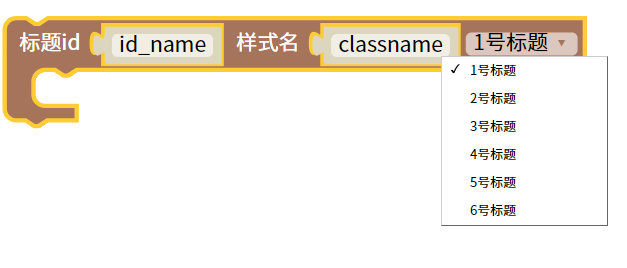
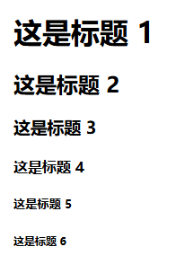

网页标签标题
=======================================================

标题（Heading）是通过 <h1> - <h6> 标签进行定义的。

<h1> 定义最大的标题。 <h6> 定义最小的标题。

::

    <body>

        <h1 id="id_name" class="classname">
        </h1>
  

    </body>
    
测试样式

