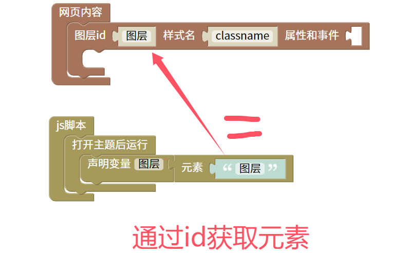

元素脚本
=======================================================

通过id获取元素。如果将它赋值给一个变量那么这个变量现在就等于获取的元素了。

    
::

    <body>

    

    </body>
    
js教程请参考

.. raw:: html

   
<a href="https://www.w3school.com.cn/js/index.asp" target="_blank">w3school</a>

   
<a href="https://www.runoob.com/js/js-tutorial.html" target="_blank">菜鸟教程</a>

