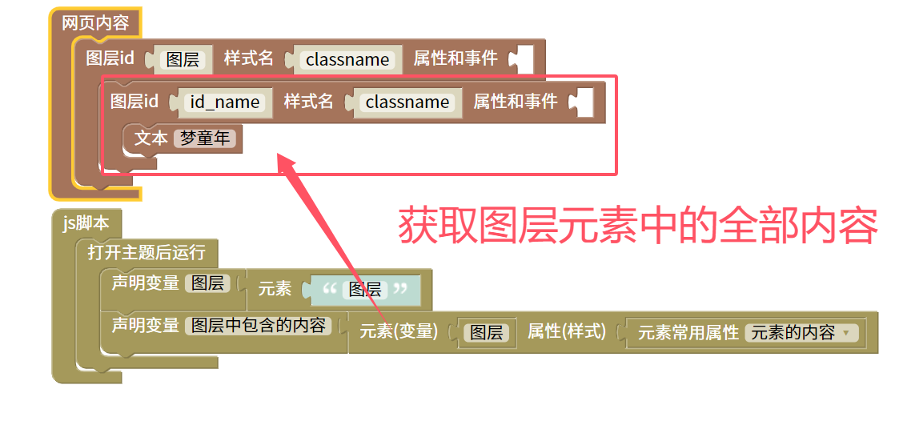

元素属性脚本
=======================================================

元素属性 ,对象.属性 这个模块不只是可以获取元素内容。因为他是一个 点 的特点还可以与其他块或文本组合使用。

    
::

    <body>

    

    </body>
    
js教程请参考

.. raw:: html

   
<a href="https://www.w3school.com.cn/js/index.asp" target="_blank">w3school</a>

   
<a href="https://www.runoob.com/js/js-tutorial.html" target="_blank">菜鸟教程</a>

