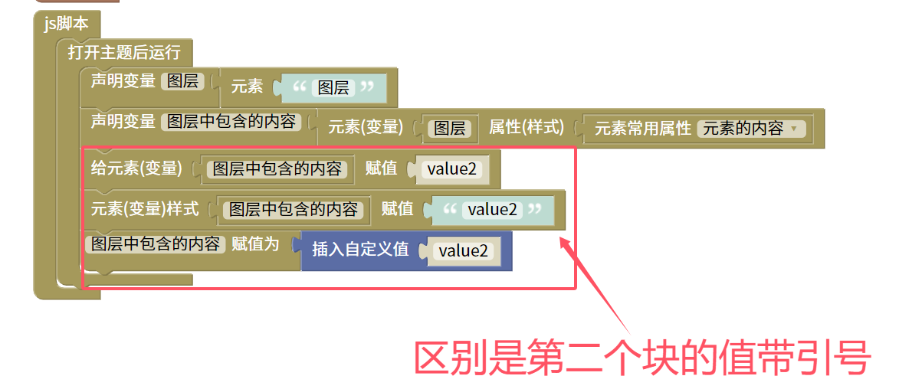

给样式...赋值..脚本
=======================================================

这个模块就是一个=（赋值）模块值是字符串。与变量赋值效果是一样的用于不能直接通过变量赋值的内容。

    
::

    <body>

    

    </body>
    
js教程请参考

.. raw:: html

   
<a href="https://www.w3school.com.cn/js/index.asp" target="_blank">w3school</a>

   
<a href="https://www.runoob.com/js/js-tutorial.html" target="_blank">菜鸟教程</a>

