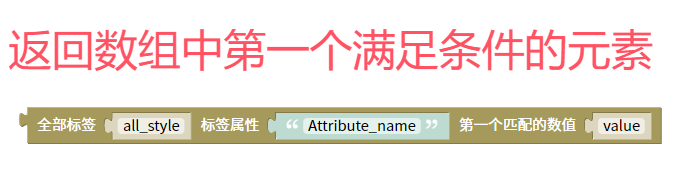

搜索全部元素中第一个匹配的数值脚本
=======================================================

搜索全部元素中第一个匹配的数值。方法返回数组中第一个满足条件的元素

::

    <body>

    

    </body>
    
js教程请参考

.. raw:: html

   
<a href="https://www.w3school.com.cn/js/index.asp" target="_blank">w3school</a>

   
<a href="https://www.runoob.com/js/js-tutorial.html" target="_blank">菜鸟教程</a>

