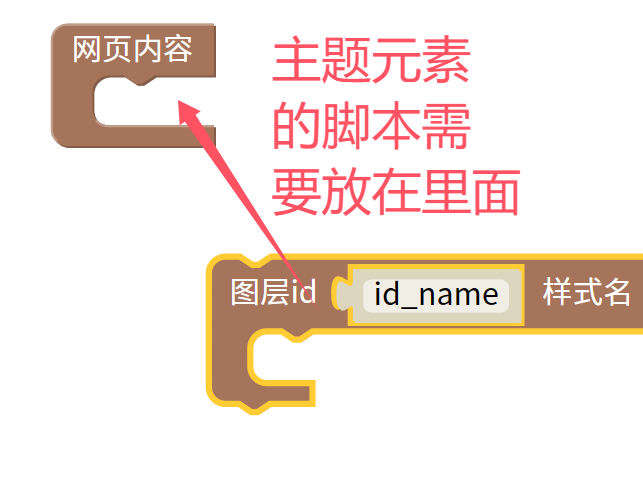

网页内容块
=======================================================

需要将所有的网页元素全部都放在网页模块中使用，否则无法正常显示。

:: 

    <!DOCTYPE html>
    <html>
    <head>
    <meta http-equiv="Content-Type" content="text/html; charset=utf-8"/>
    <meta http-equiv="X-UA-Compatible" content="IE=Edge,chrome=1"/>
    <meta name="viewport" content="width=device-width, initial-scale=1.0, minimum-scale=0.5, maximum-scale=2.0, user-scalable=yes" />

    <link rel="stylesheet" href="file/bootstrap/css/bootstrap.min.css">
    
    

    </head>

    <body>
    <!-- 放入"网页内容块"的其他元素块就会写到这里面 -->
    

    </body>
    </html>
