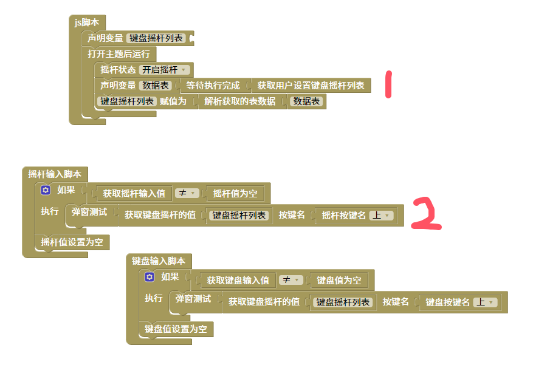
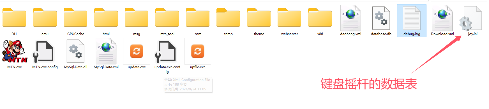

获取用户设置键盘摇杆列表脚本
=======================================================

1 通过获取用户设置键盘摇杆列表块来获取MTN软件发送的用户设置的键盘摇杆列表。然后解析成json数据。

2 通过获取键盘摇杆的值和键盘按键名，摇杆按键名的块组合获取上面解析的json数据。

::

    <body>
    

    

    

    </body>
    
js教程请参考

.. raw:: html

   
<a href="https://www.w3school.com.cn/js/index.asp" target="_blank">w3school</a>

   
<a href="https://www.runoob.com/js/js-tutorial.html" target="_blank">菜鸟教程</a>

