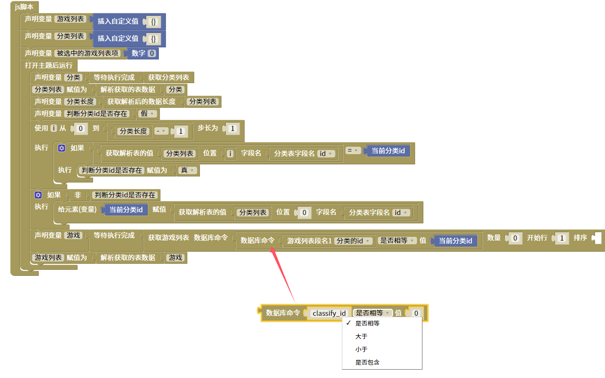

数据库命令脚本
=======================================================

数据库搜素命令。参考.net de sql数据库搜素命令

::

    <body>
    
    
    </body>
    
js教程请参考

.. raw:: html

   
<a href="https://www.w3school.com.cn/js/index.asp" target="_blank">w3school</a>

   
<a href="https://www.runoob.com/js/js-tutorial.html" target="_blank">菜鸟教程</a>

