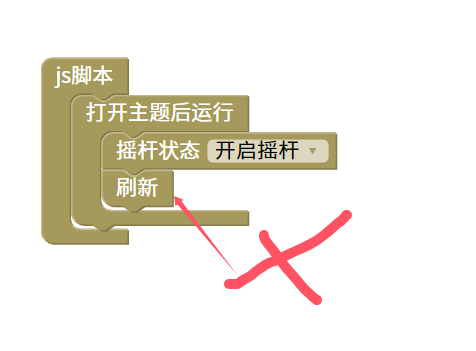

刷新脚本
=======================================================

重复执行mtn_init（）初始化函数。重新扫描rom和rom资料，切记刷新块一定要放在某些用户交互事件中。避免重复执行

刷新脚本只是重复了mtn_init（）函数。并未刷新网页要注意全局变量的初始化和一些元素事件的重复绑定问题。

    
::

    <body>

    

    </body>
    
js教程请参考

.. raw:: html

   
<a href="https://www.w3school.com.cn/js/index.asp" target="_blank">w3school</a>

   
<a href="https://www.runoob.com/js/js-tutorial.html" target="_blank">菜鸟教程</a>

