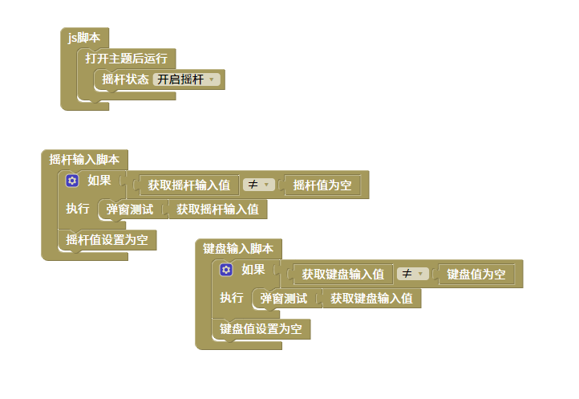

获取键盘 摇杆 输入值为空脚本
=======================================================

摇杆和键盘值为js脚本的全局变量，为了不影响其使用，所以需要清空。

::

    <body>
    

    

    

    </body>
    
js教程请参考

.. raw:: html

   
<a href="https://www.w3school.com.cn/js/index.asp" target="_blank">w3school</a>

   
<a href="https://www.runoob.com/js/js-tutorial.html" target="_blank">菜鸟教程</a>

