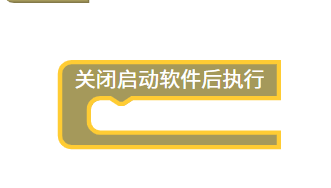

关闭启动软件后执行脚本
=======================================================

当启动游戏后，MTN软件会自动最小化到任务栏。这时视频，音频如果是自动带声音播放的会影响游戏的声音。需要使用这个块来关闭声音。

::

    <body>
    
    
    </body>
    
js教程请参考

.. raw:: html

   
<a href="https://www.w3school.com.cn/js/index.asp" target="_blank">w3school</a>

   
<a href="https://www.runoob.com/js/js-tutorial.html" target="_blank">菜鸟教程</a>

