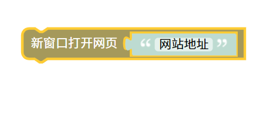

新窗口打开网页脚本
=======================================================

输入网站地址注意要写http或https网站协议，新窗口打开网站。例如www.baidu.com 应写为 https://www.baidu.com

::

    <body>
    
    
    </body>
    
js教程请参考

.. raw:: html

   
<a href="https://www.w3school.com.cn/js/index.asp" target="_blank">w3school</a>

   
<a href="https://www.runoob.com/js/js-tutorial.html" target="_blank">菜鸟教程</a>

