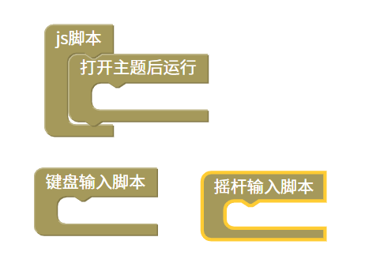
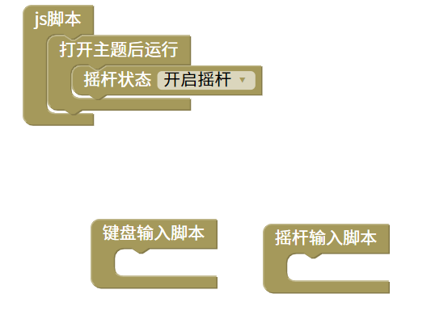

键盘和摇杆输入脚本
=======================================================

使用键盘或摇杆函数时可以通过MTN软件获取设置的键盘或摇杆的值，需要分开放置。
需要注意的是如果要使用摇杆输入脚本需要开启摇杆。

    
::

    <body>

    

    

    

    </body>
    
js教程请参考

.. raw:: html

   
<a href="https://www.w3school.com.cn/js/index.asp" target="_blank">w3school</a>

   
<a href="https://www.runoob.com/js/js-tutorial.html" target="_blank">菜鸟教程</a>

